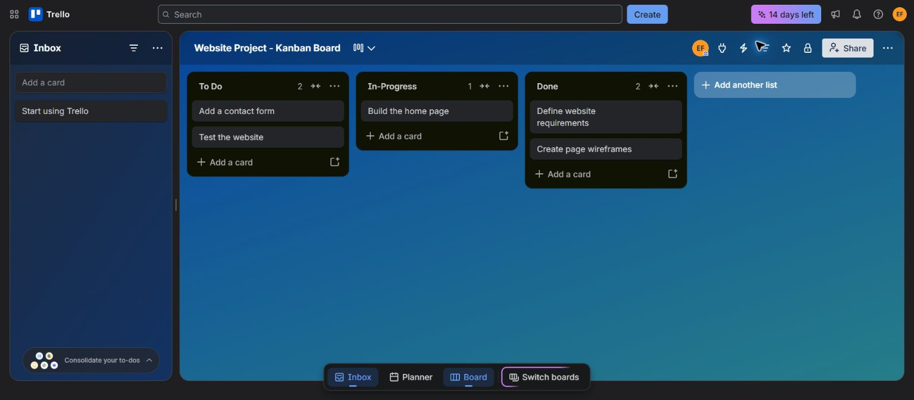

# CSA1020 — Software Engineering

Software engineering experiments by **Emadfar007**.

| Experiment | Description | Files |
| --- | --- | --- |
| 01 | Trello Kanban board with five sample tasks and workflow simulation | [Kanban Board](experiments/experiment-01-kanban-board/README.md) |
| 02 | Desktop Figma prototype and local bus booking website with accounts, editable tickets, and personal reviews | [Bus Ticket Booking](experiments/experiment-02-bus-ticket-booking/README.md) |
| 03 | E-commerce mobile prototype in Figma, with a local shopping app and stakeholder review workflow | [E-commerce Stakeholder Prototype](experiments/experiment-03-ecommerce-mobile-app/README.md) |
| 04 | Jira Scrum project with eight prioritized stories, a one-week sprint, workflow simulation, and dated Timeline categories | [Jira Scrum](experiments/experiment-04-jira-scrum/README.md) |
| 05 | Library Management System requirements categorized and justified using MoSCoW in an Excel workbook | [Library MoSCoW Prioritization](experiments/experiment-05-library-moscow/README.md) |
| 06 | Jira and Confluence integration for Library Management System task tracking and sprint progress monitoring | [Jira and Confluence Integration](experiments/experiment-06-jira-confluence/README.md) |

Each experiment includes only Aim, Tools Required, Algorithm, Output Screenshots, and Result.

## Experiment previews

### Kanban board

### Bus booking desktop prototype

### E-commerce mobile prototype

### Jira Scrum project

The sample Jira project includes a dated Timeline and detailed ownership, acceptance criteria, and dependencies. Its current simulated progress snapshot shows four stories To Do, three In Progress, and one Done. Original sprint-start and sprint-end screenshots are included in Experiment 04.

### Library Management System priorities

Experiment 05 includes a downloadable Excel workbook with all ten requirements, impact, feasibility, and priority justification. The workbook can also be imported into Google Sheets.

### Library Management System task tracking

Experiment 06 links seven Jira stories to a Confluence project overview. Its simulated checkpoint shows two Done, three In Progress, and two To Do tasks, with a manually updated completion snapshot of **28.6%**.

## Local testing

The bus booking website and FORME e-commerce app use HTML, CSS, and JavaScript. Their source is included in Experiments 02 and 03. See each experiment's README for local testing instructions. Both apps use Node.js to run their loopback-only testing servers. SwiftBus includes local account registration/login, editable passenger and travel-point details, PDF tickets, and personal bus reviews.

Both apps are testing prototypes with sample data and simulated bookings or orders. They have not been deployed; no real reservations, payments, or email delivery are connected. Experiment 03 includes two interface directions and a local feedback and approval log; real stakeholder approval remains pending.
