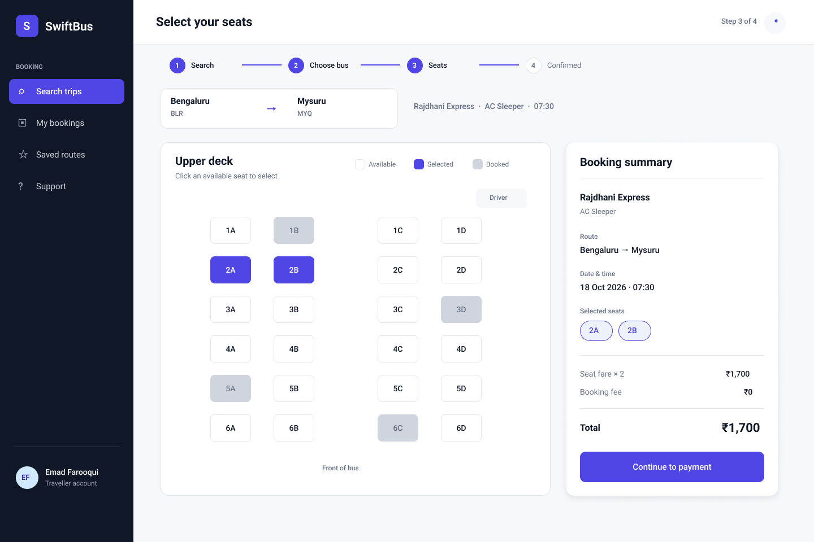
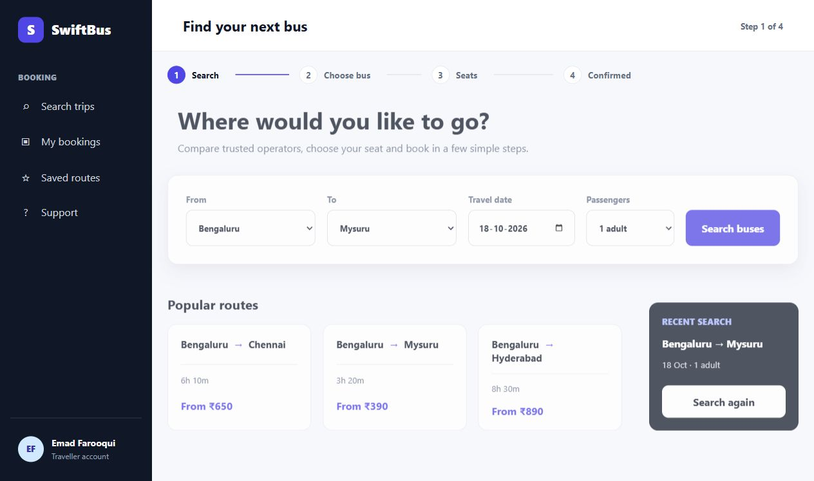

# Experiment 02 — Bus Ticket Booking System Prototype

## Aim

Sketch a simple bus ticket booking system in Figma and create a desktop prototype covering the booking workflow.

## Tools

- Figma for editable desktop screens and prototype navigation.
- HTML, CSS, and JavaScript for a local interactive implementation.

## Figma design

[Open the editable Figma prototype](https://www.figma.com/design/1Y71bhdPTjVX7d3ubsW6LV/Bus-Ticket-Booking-System---Prototype?node-id=11-177&p=f).

The final Figma file contains four **1440 × 960 desktop screens**. The previous mobile reference screens were removed. Figma access depends on the file's existing permissions.

## Procedure

1. Sketch a trip search form with departure city, destination, travel date, and passenger count.
2. Design bus results showing operators, departure and arrival times, ratings, fares, and seat availability.
3. Design a seat map distinguishing available, selected, and booked seats, alongside a fare summary.
4. Design a booking confirmation with the route, date, bus, selected seats, total, and sample PNR.
5. Link the primary buttons to simulate **Search → Choose bus → Seats → Confirmed**.
6. Implement a local testing website with the same flow.

## Desktop screenshots from Figma

### 1. Search trip


### 2. Choose a bus


### 3. Select seats



### 4. Booking confirmation


## Local testing website

Source is in [website/](website/). It has no build step and requires no package installation.

Open `website/index.html` in a modern browser, or run a local server from this experiment's folder:

```powershell
python -m http.server 4817 --bind 127.0.0.1 --directory website
```

Then open **http://127.0.0.1:4817/**. Stop the server with **Ctrl+C**.

### Local browser screenshot



### Implemented interactions

- Route, date, and passenger selection; validation for matching departure and destination cities.
- Three sample buses with departure-time and bus-type filters and sorting.
- Available-seat selection and removal, with booked seats disabled.
- Fare recalculation based on selected seats and the chosen bus.
- Simulated confirmation showing ticket details and a sample PNR.
- Text-file ticket download and return to search.

### Testing record

The original local browser check reached the confirmation screen after searching, choosing a bus, and selecting seats **2A, 2B, and 3A**, with a total of **₹2,550**. The browser console contained no errors in that check. The ticket download control displayed its success toast; automatic browser download-event confirmation timed out, so that event was not independently verified.

These saved screenshots document the original experiment rather than a new browser test on every commit.

## Scope

This is a **testing prototype**. Bus data and bookings are simulated in the browser. It does not reserve real seats, charge payments, send email, authenticate users, or persist bookings. The “Continue to payment” button advances directly to simulated confirmation. The passenger selector is displayed, while the fare is determined by the seats selected.

The website remains undeployed. This repository stores source, documentation, and screenshots for review and local testing.

## Result

An editable four-screen desktop Figma prototype and a local interactive website demonstrate the bus booking workflow.
