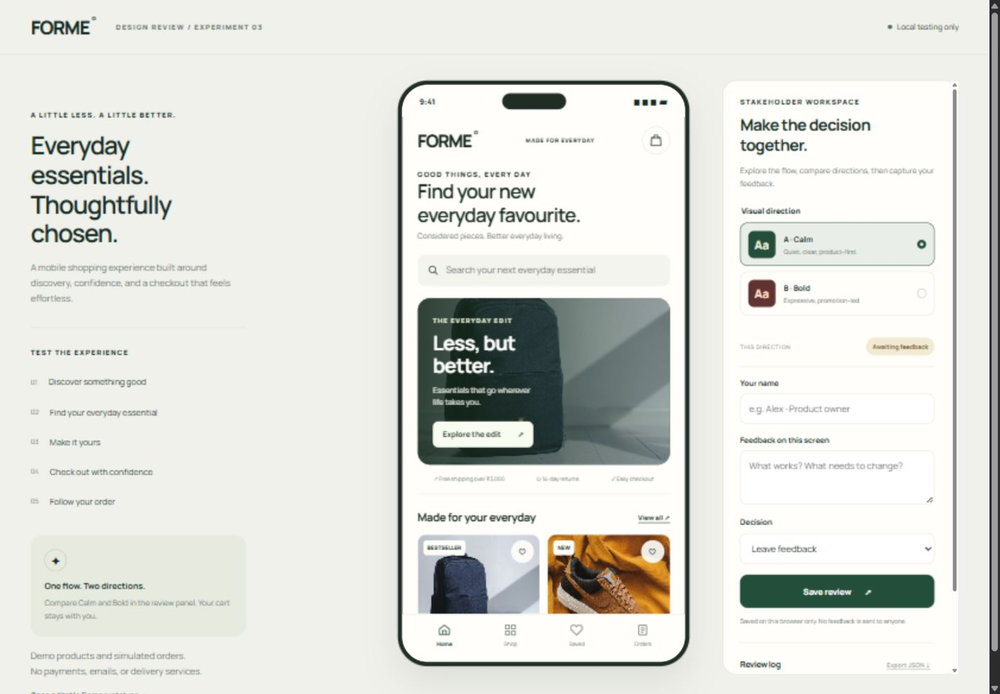
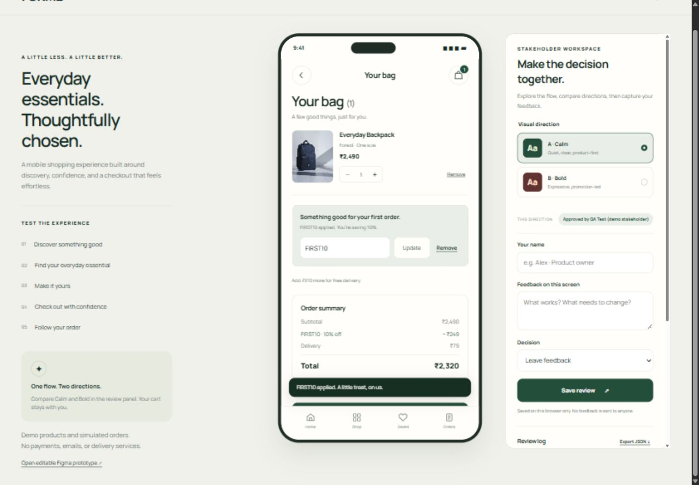
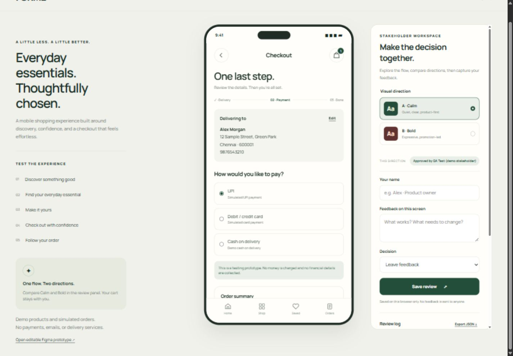
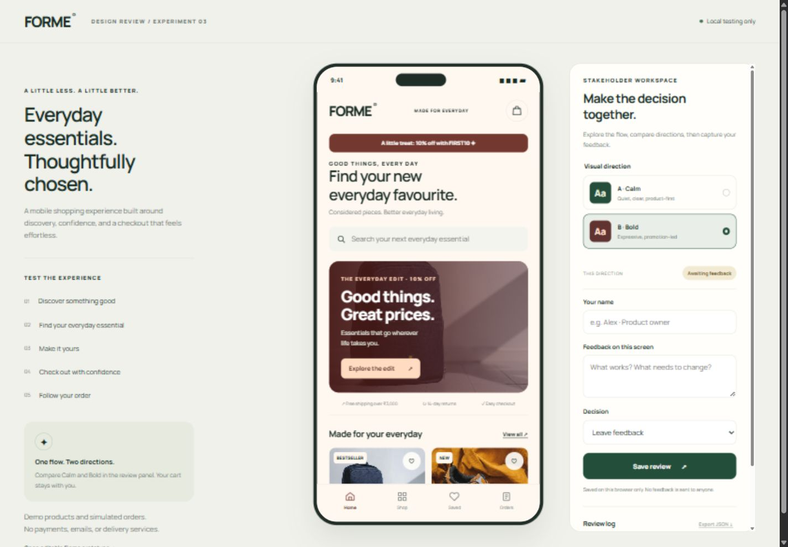

# Experiment 03 — E Commerce Mobile App Prototype for Stakeholder Review

## Aim

To create an interactive e-commerce mobile app prototype using Figma, compare conflicting interface preferences, and provide a working local app through which stakeholders can give feedback and record approval decisions.

## Tools Required

- Figma account and internet connection.
- Web browser.
- HTML, CSS, and JavaScript.
- Node.js for the local testing server.
- Manrope font and product photography from Unsplash, stored locally with source references in `asset-sources.json`.

## Algorithm

1. Identify the competing interface preferences: a calm, product-first layout and a bold, promotion-led layout.
2. Create **390 × 844 pixel** mobile frames in Figma for discovery, collection browsing, product selection, shopping bag, delivery details, payment review, confirmation, and the alternative visual direction.
3. Use editable text, vector icons, reusable product cards, shared controls, and separate product images. Connect the shopping flow as **Discover → Collection → Product → Bag → Delivery → Payment → Confirmation**.
4. Add a stakeholder comparison area and two prototype starting points so both directions can be discussed in Figma. Use Figma comments for shared feedback.
5. Implement the same experience in the local `dist/` app, including search, categories, sorting, favourites, product options, stock limits, cart updates, and the `FIRST10` sample discount.
6. Run the local app from this experiment's folder:

   ```powershell
   node server.cjs
   ```

   Open **http://127.0.0.1:4823/**. On the current computer, `Start-FORME.ps1` also locates the bundled Node.js runtime. The server binds only to this computer's loopback address.

7. Select a product and its options, add it to the bag, update quantities, and review subtotal, discount, delivery, and total. Complete guest checkout using **Fill sample details**, select a simulated payment method, and place a demo order.
8. Open **Orders** and advance the sample order through **Placed → Packed → Shipped → Delivered**. Download the demo receipt.
9. Compare **A · Calm** and **B · Bold** in the review panel. Enter a reviewer name, give screen-specific feedback, and choose **Leave feedback**, **Request changes**, or **Approve this direction**. Export the review log as JSON when needed.
10. Verify required size selection, invalid promo codes and PIN codes, stock limits, cart persistence, checkout, tracking, downloaded files, and review decisions. Use **Start a fresh testing session** to clear prototype test data before another review. Keep the app unpublished.

## Output Screenshots

**Editable Figma Shopping Flow and Stakeholder Comparison**


**Local App with Direction A and Review Panel**



**Shopping Bag and Discount Calculation**



**Guest Checkout and Simulated Payment Review**



**Mobile Order Tracking**


**Stakeholder Feedback and Approval Controls**


**Demo Order Confirmation**


**Direction B for Comparison**



[Open the editable Figma design](https://www.figma.com/design/eOVcbMChHuLdyBYFjy3JN3?node-id=5-210).

[Open the Figma shopping prototype](https://www.figma.com/proto/eOVcbMChHuLdyBYFjy3JN3?node-id=5-217&starting-point-node-id=5%3A217).

## Result

A polished Figma mobile prototype and an unpublished local app were created. The complete shopping, guest checkout, simulated order tracking, and stakeholder feedback workflows were tested in the browser. Receipts and review logs were downloaded and checked. The two visual directions can be compared before a stakeholder decision is recorded.

Orders and payments are simulated. Cart, favourites, demo addresses, orders, and review decisions persist in the testing browser. Screenshots containing approvals show explicitly labelled QA examples; real stakeholder approval remains pending. The final local session was reset to **Awaiting feedback** for actual stakeholder testing.
