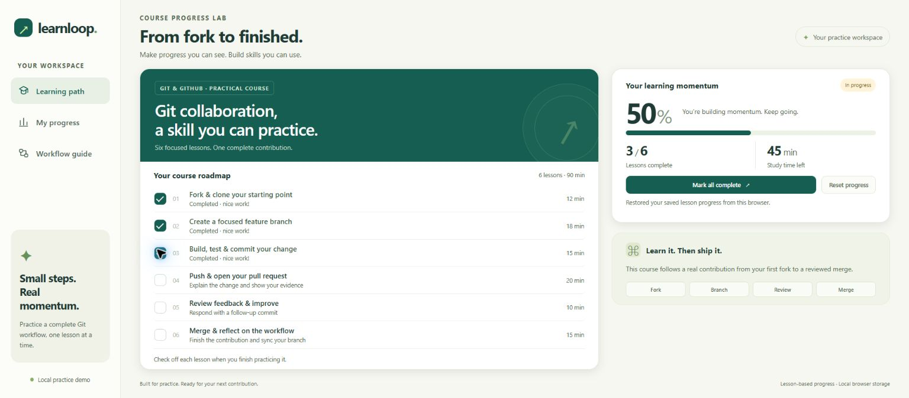
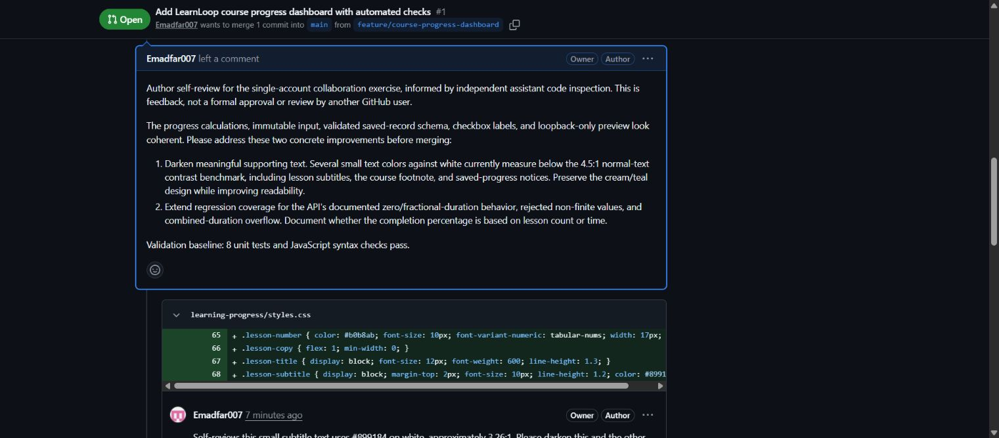
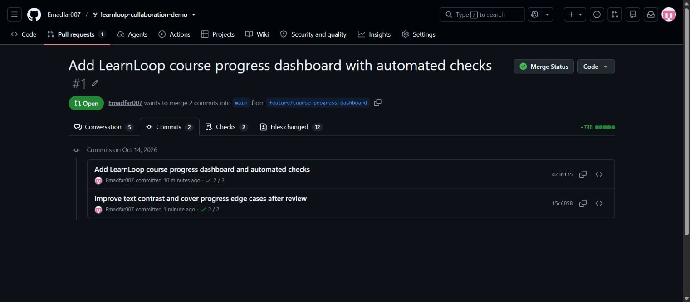
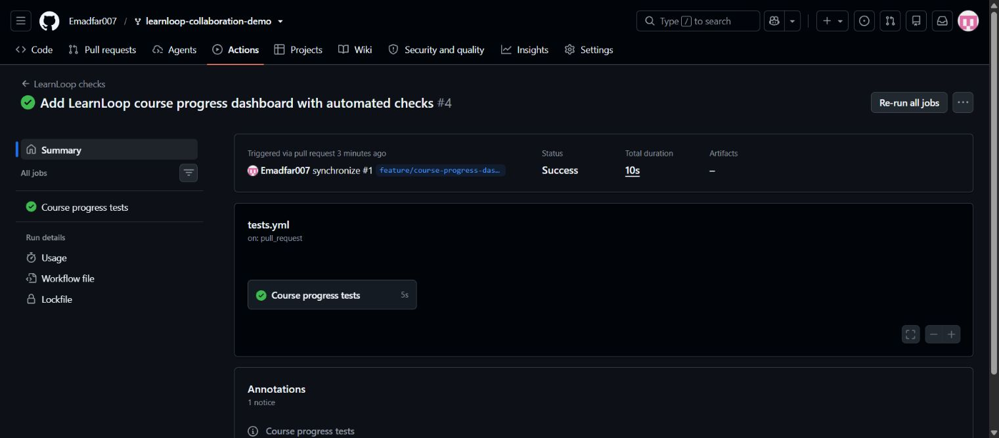

# Experiment 9: Git and GitHub Collaboration with LearnLoop

## Aim

Demonstrate a complete fork, branch, feature, pull request, feedback, follow-up, and merge workflow through a working LearnLoop course-progress dashboard.

**Account and approval scope:** all GitHub actions use **Emadfar007**. Review comments are disclosed **author self-review informed by independent assistant code inspection**. GitHub prevents authors from approving their own pull requests, so this exercise does not claim a second collaborator or independent human approval. An owner merge targets the user's fork, not octocat's upstream repository. [GitHub review documentation](https://docs.github.com/en/pull-requests/how-tos/review-pull-requests/approving-a-pull-request-with-required-reviews).

## Tools Required

- Git and GitHub using the **Emadfar007** account.
- Node.js 24, npm scripts, and the built-in Node test runner.
- JavaScript, HTML, and CSS for the local dashboard.
- GitHub Actions for automated checks; browser for local testing and screenshots.
- Independent assistant code inspection supporting transparent author self-review.

## Algorithm

1. Fork the public [octocat/Spoon-Knife](https://github.com/octocat/Spoon-Knife) demonstration repository into [Emadfar007/learnloop-collaboration-demo](https://github.com/Emadfar007/learnloop-collaboration-demo). The starting source revision is `d0dd1f61b33d64e29d8bc1372a94ef6a2fee76a9`. A fork is a separate repository connected to its upstream source. [GitHub fork documentation](https://docs.github.com/en/pull-requests/reference/forks).
2. Clone the fork and create `feature/course-progress-dashboard`. Use the fork as the push destination and the fork's own `main` as the pull-request base.
3. Build the LearnLoop dashboard for **six lessons totaling 90 minutes**. Provide completion checkboxes, lesson-based percentage, completed/total counts, remaining minutes, Complete All, Reset, and browser-local saved progress. Keep website testing on localhost.
4. Add a pure JavaScript progress calculator, input validation, automated tests, API documentation, and GitHub Actions checks. Create and push the initial feature commit [d23b135](https://github.com/Emadfar007/learnloop-collaboration-demo/commit/d23b1354f48953248f13df546f3262eac4bd8bfd).
5. Open [pull request #1](https://github.com/Emadfar007/learnloop-collaboration-demo/pull/1) from `feature/course-progress-dashboard` into the fork's `main`, with the feature summary and validation evidence.
6. Inspect the actual diff independently and post **two real inline author self-review comments**, explicitly identifying the supporting assistant inspection. Review feedback addresses readable text contrast and progress-calculator boundary coverage/API clarity.
7. Implement the feedback in follow-up commit [15c6058](https://github.com/Emadfar007/learnloop-collaboration-demo/commit/15c6058d21aebe458259cb55ea0c7bfc84ad45df): improve contrast, add edge-case tests, and clarify the documented API. Reply to both review comments with the fixes and resolve both threads after checking the revision.
8. Run the final tests: **13 pass**. Confirm the final-head [GitHub Actions run 38582664261](https://github.com/Emadfar007/learnloop-collaboration-demo/actions/runs/38582664261) succeeds.
9. Verify the actual dashboard workflow:

| Browser action | Completed lessons | Progress | Remaining time |
|---|---:|---:|---:|
| Initial or Reset | 0/6 | 0% | 90 minutes |
| Complete three lessons | 3/6 | 50% | 45 minutes |
| Reload saved progress | 3/6 | 50% | 45 minutes |
| Uncheck the branch lesson | 2/6 | 33% | 63 minutes |
| Complete All | 6/6 | 100% | 0 minutes |

The percentage is based on completed lesson count, not duration; remaining time is calculated from unfinished lessons. Progress survives reload in the same browser.
10. Merge the reviewed pull request into the fork's `main` on **14 October 2026** through a disclosed owner merge. The verified merge commit is [1ab5010](https://github.com/Emadfar007/learnloop-collaboration-demo/commit/1ab501074eff730819c2fdf29a247707d1a8f64e). PR #1 is closed and marked merged. Fetch `origin/main` and verify it retains both feature commits and matches the feature tree exactly; the original root `index.html` and `styles.css` remain unchanged from the upstream source.

**Verified workflow:** the fork, feature, pull request, two review threads, follow-up changes, 13 passing tests, successful final-head CI, browser workflow, and merge into the user's fork are confirmed.

## Output Screenshots

1. **Public fork:** the repository's relationship to octocat/Spoon-Knife.

2. **Feature branch:** the course-progress feature branch and its initial changes.

3. **Working dashboard:** the local LearnLoop course-progress interface.

4. **Open pull request:** the feature proposes changes into the fork's own main branch.

5. **Review feedback:** genuine inline author self-review comments disclose the independent assistant inspection.

6. **Follow-up commits:** the pull-request history contains the initial implementation and the review-response commit.

7. **Passing checks:** the final-head GitHub Actions run succeeds after the follow-up changes.

8. **Merged pull request:** GitHub confirms PR #1 was merged into the user's fork main branch.

## Result

Implemented a working local LearnLoop dashboard and demonstrated a genuine GitHub feature-review workflow in [pull request #1](https://github.com/Emadfar007/learnloop-collaboration-demo/pull/1). Two inline self-review comments were addressed in a follow-up commit and both threads resolved. **All 13 final tests pass**, final-head GitHub Actions checks succeeded, and the dashboard's completion, reset, and reload-persistence flows were verified.

PR #1 was merged into **Emadfar007/learnloop-collaboration-demo's main** as commit [1ab5010](https://github.com/Emadfar007/learnloop-collaboration-demo/commit/1ab501074eff730819c2fdf29a247707d1a8f64e). The remote main branch contains both feature commits and the verified feature tree. The dashboard remains available for local testing. This single-account exercise demonstrates transparent author self-review and a completed owner merge; it does not constitute independent human approval.
