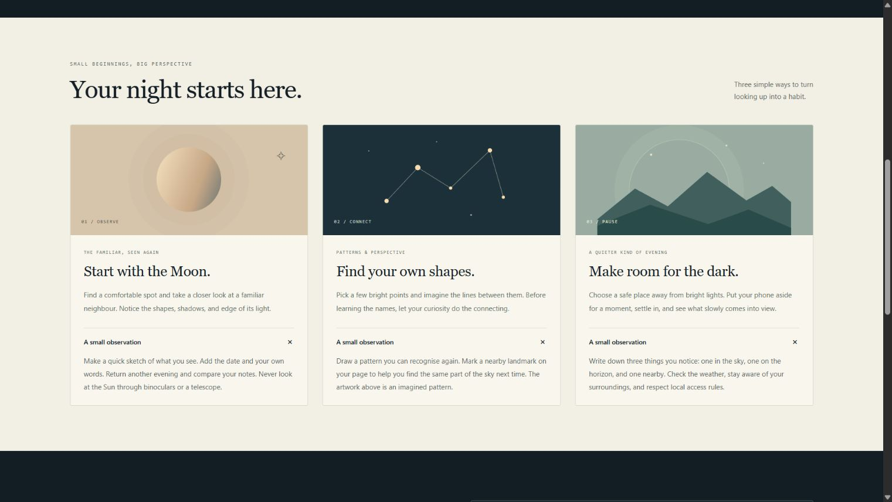
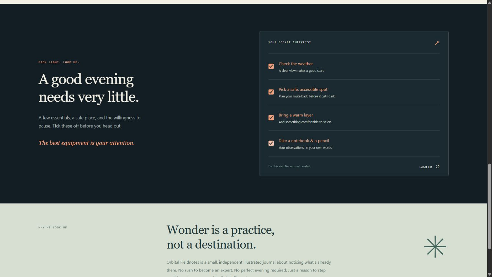
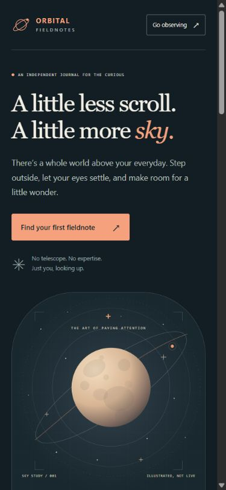
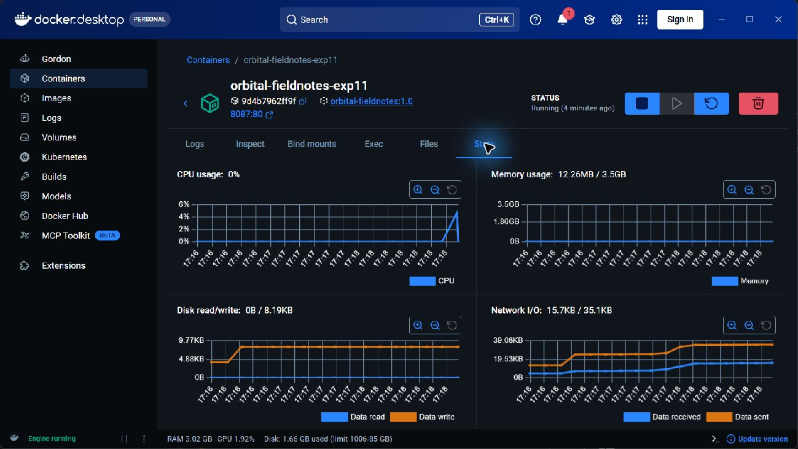
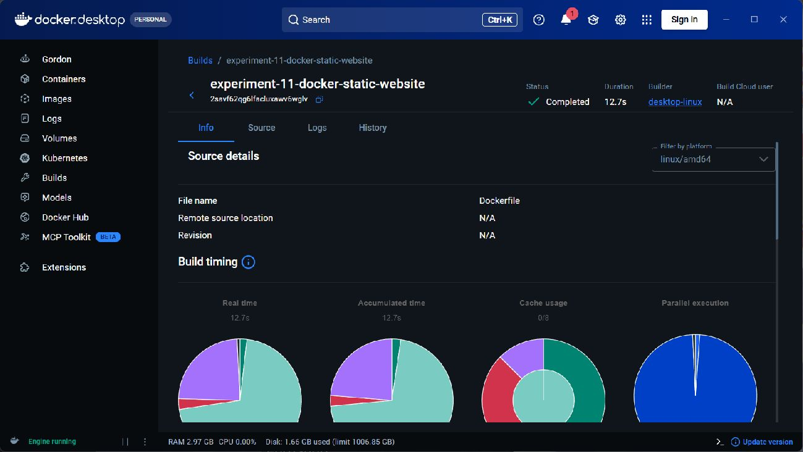

# Experiment 11: Static Website with Docker and Nginx

## Aim

Create **Orbital Fieldnotes**, a distinctive static night-sky journal, package its HTML and CSS inside a Docker image, and serve it locally using Nginx. Demonstrate image building, container startup, and browser access with recorded evidence.

## Tools Required

**Browser Docker lab:** [Open the Codespaces IDE](https://miserable-cobweb-4j9pjv79r7w7fjrqw.github.dev/) · [Manage or restart the lab](https://github.com/codespaces) · [Browser lab guide](https://github.com/Emadfar007/CSA1020---Software-Engineering/tree/main/browser-lab). Sign in as **Emadfar007**, resume the Codespace if stopped, and run `bash browser-lab/bin/lab start 11` from the repository root before opening this experiment's private app links. Starting a profile stops the other lab profiles while preserving their data. The original local commands, screenshots and test evidence below remain the historical experiment record.

- Docker Desktop **4.96.3**, Docker Engine/CLI **29.9.2**, and Linux containers through WSL 2.
- The official [Nginx Docker image](https://hub.docker.com/_/nginx), resolving to **Nginx 1.30.6** in this run.
- HTML5 and CSS3; a text editor and a browser.
- PowerShell or another terminal for the Docker commands.

### Quick access links

| What to open | Link |
| --- | --- |
| Open or manage the browser lab | [Codespaces IDE](https://miserable-cobweb-4j9pjv79r7w7fjrqw.github.dev/) · [Start or stop Codespaces](https://github.com/codespaces) · [Lab guide](https://github.com/Emadfar007/CSA1020---Software-Engineering/tree/main/browser-lab) |
| Open the website | [Orbital Fieldnotes - private browser app](https://miserable-cobweb-4j9pjv79r7w7fjrqw-8087.app.github.dev/) |
| Check the container response | [Browser health check](https://miserable-cobweb-4j9pjv79r7w7fjrqw-8087.app.github.dev/healthz) |
| Source and container configuration | [Experiment folder](https://github.com/Emadfar007/CSA1020---Software-Engineering/tree/main/experiments/experiment-11-docker-static-website) · [Dockerfile](https://github.com/Emadfar007/CSA1020---Software-Engineering/blob/main/experiments/experiment-11-docker-static-website/Dockerfile) · [Nginx configuration](https://github.com/Emadfar007/CSA1020---Software-Engineering/blob/main/experiments/experiment-11-docker-static-website/nginx.conf) |
| View the output | [All six screenshots](https://github.com/Emadfar007/CSA1020---Software-Engineering/tree/main/experiments/experiment-11-docker-static-website/screenshots) · [Build and verification evidence](https://github.com/Emadfar007/CSA1020---Software-Engineering/tree/main/experiments/experiment-11-docker-static-website/evidence) |
| Open the experiment collection | [All experiments](https://github.com/Emadfar007/CSA1020---Software-Engineering) |

The website and health links above use the private Codespaces runtime and require the Experiment 11 profile to be running. Docker Desktop is not required for this browser workflow. The original image-building procedure below is preserved for reproducibility.


Private app links require both a running profile and GitHub sign-in as Emadfar007. This Codespace uses a 30-minute idle timeout and 30-day inactive retention; free usage remains subject to its monthly quota, with paid usage blocked.

## Algorithm

1. Create `site/index.html` with semantic HTML, an original inline SVG illustration, three expandable fieldnotes, and an observation checklist. Add `site/styles.css` for the responsive navy, cream, and orange interface. The website uses no external assets, JavaScript, packages, or build system.
2. Create `nginx.conf` to serve `/usr/share/nginx/html` on port 80, return a proper 404 for missing files, and expose a lightweight `/healthz` endpoint.
3. Create the Dockerfile below. `COPY` includes the website in the image, so the running container does not require a host directory mount. The Nginx image supplies its foreground startup command.

```dockerfile
FROM nginx:stable-alpine
COPY nginx.conf /etc/nginx/conf.d/default.conf
COPY site/ /usr/share/nginx/html/
EXPOSE 80
HEALTHCHECK --interval=15s --timeout=3s --start-period=5s --retries=3 \
  CMD wget -q -O /dev/null http://127.0.0.1/healthz || exit 1
```

4. Add `.dockerignore` so only the website, Dockerfile, and Nginx configuration enter the build context. Start Docker with Linux containers, then open a terminal in this experiment's directory.
5. Confirm that both client and server are available:

```powershell
docker version
```

6. Build the image and run the container:

```powershell
docker build --pull --progress=plain -t orbital-fieldnotes:1.0 .
docker run -d --name orbital-fieldnotes-exp11 -p 127.0.0.1:8087:80 orbital-fieldnotes:1.0
```

The published port is restricted to this computer. No public deployment or registry upload is required.

7. Wait for the container health to become **healthy**, then inspect the container and verify Nginx:

```powershell
docker ps --filter name=orbital-fieldnotes-exp11
docker exec orbital-fieldnotes-exp11 nginx -t
docker inspect --format '{{.State.Health.Status}}' orbital-fieldnotes-exp11
curl.exe -I http://127.0.0.1:8087/
curl.exe http://127.0.0.1:8087/healthz
```

8. Open [http://127.0.0.1:8087/](http://127.0.0.1:8087/) in a browser. Test the header and hero links, expand all three observation notes, tick the four checklist items, and use **Reset list**. Verify keyboard operation and the responsive layout.
9. When finished, stop the container with `docker stop orbital-fieldnotes-exp11`. Restart the same container with `docker start orbital-fieldnotes-exp11`.

## Output Screenshots

The website screenshots below were captured from **Nginx running inside the Docker container at http://127.0.0.1:8087/**. The two Docker Desktop screenshots show the actual running container and completed image build.

1. **Docker-served desktop website:** the original moon illustration, editorial typography, and working navigation.


2. **Expanded fieldnotes:** three native observation guides opened independently.



3. **Interactive checklist:** selected preparation items before using Reset list.



4. **Phone layout:** the Docker-served website at a width of 390 pixels, verified without horizontal overflow.



5. **Running Docker container:** Docker Desktop shows the container name, image tag, published port, running status, and resource statistics.



6. **Successful image build:** Docker Desktop records the completed build, Dockerfile source, and build timing.



Recorded evidence: [build output](evidence/build-log.txt), [actual Docker commands](evidence/commands.json), [container status](evidence/container-status.txt), [Nginx configuration test](evidence/nginx-config-test.txt), [HTTP and runtime verification](evidence/runtime-verification.json), [11 browser checkpoints](evidence/browser-verification.json), and [Nginx request logs](evidence/nginx-logs.txt). The base-image digest and final image identity are retained in the build output and [image metadata](evidence/image-inspect.json).

## Result

Successfully created the static website, built image **`orbital-fieldnotes:1.0`**, and started container **`orbital-fieldnotes-exp11`** using Nginx. The website is available locally at **[http://127.0.0.1:8087/](http://127.0.0.1:8087/)**.

| Verification | Observed result |
|---|---|
| Image build | Completed successfully; actual build output and Docker Desktop proof captured |
| Container status | Running and **healthy** |
| Nginx configuration | `nginx -t` passed |
| Website, CSS, SVG icon, health endpoint | All returned **HTTP 200** |
| Missing page | Returned the expected **HTTP 404** |
| Published port | **127.0.0.1:8087 → container port 80**, restricted to this computer |
| Host directory mounts | **None**; the website files are packaged inside the image |
| Browser workflow | **11 checks passed**, including navigation, mouse/keyboard disclosures and checklist, reset, and phone layout |
| Browser console | No warnings or errors during the recorded checks |

The container remains running for local testing. The final report includes six screenshots and the recorded build, runtime, and browser evidence. No public deployment or image-registry upload was performed.
