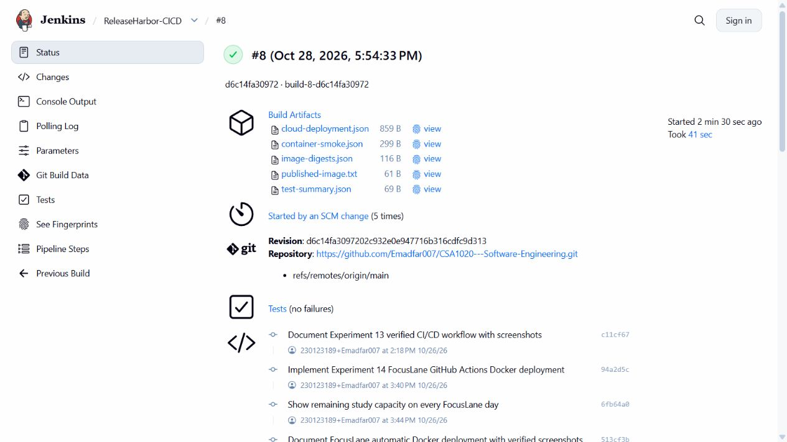
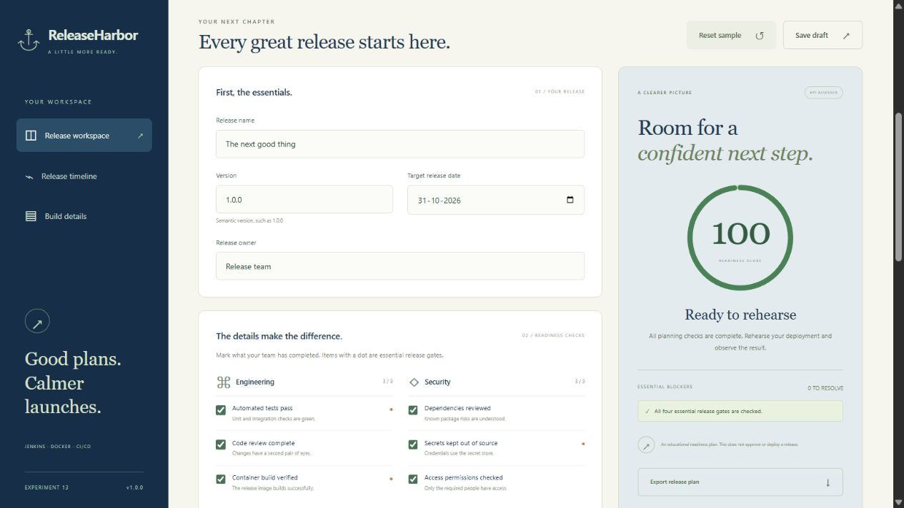
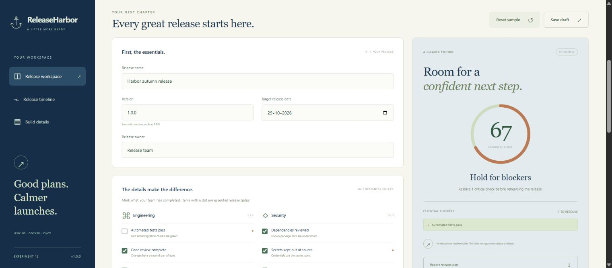
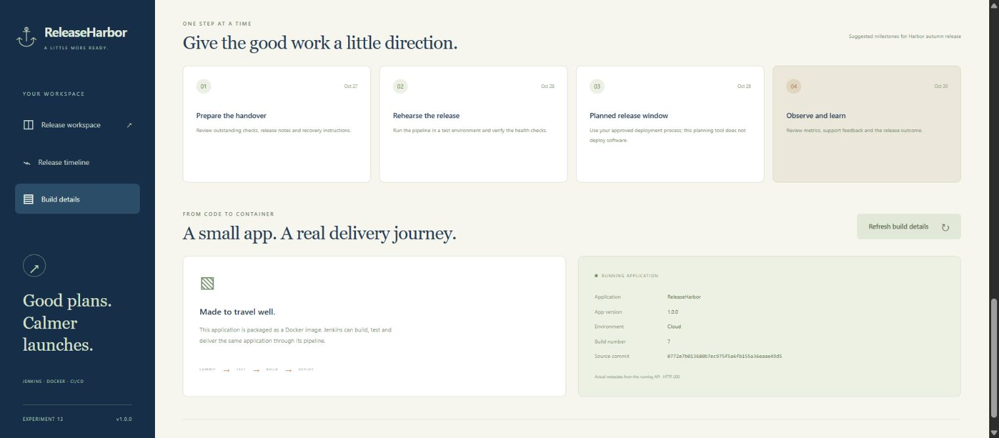
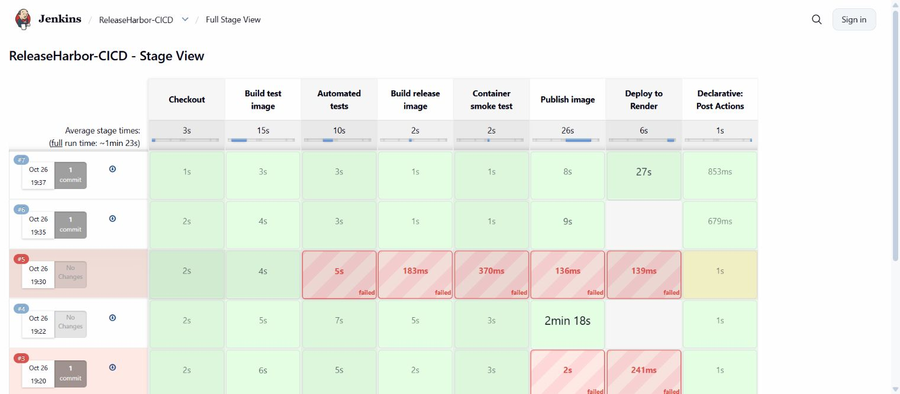
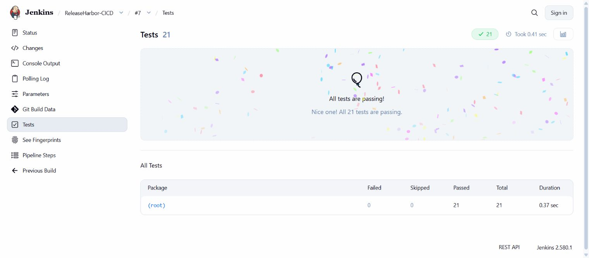
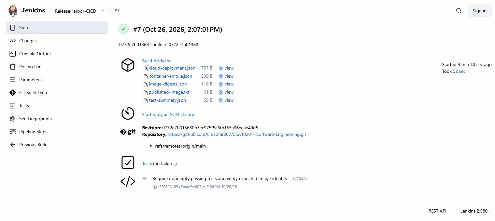
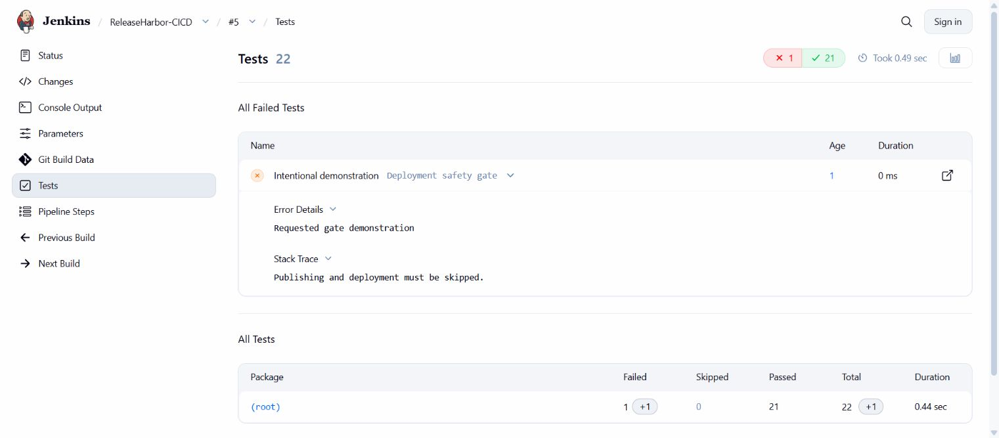
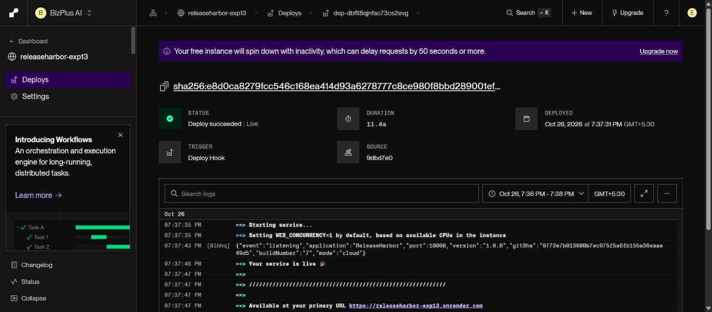
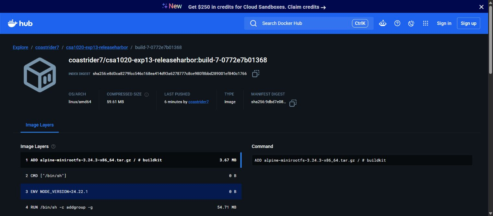

# Experiment 13 — ReleaseHarbor: Jenkins CI/CD with Docker

## Aim

To run Jenkins in the existing private Codespaces lab, automatically build and test ReleaseHarbor after source commits, publish the tested Docker image, deploy its immutable digest into the dedicated Docker daemon and verify the updated browser application.

The sample application, **ReleaseHarbor**, helps a team prepare a release through editable release details, twelve readiness checks, critical blockers, a timeline, saved browser drafts and JSON export. The checklist is a planning aid; Jenkins performs the actual CI/CD work.

## Tools Required

**Browser runtime - updated 28 October 2026:** Sign in as **Emadfar007**, resume the [existing Codespace](https://miserable-cobweb-4j9pjv79r7w7fjrqw.github.dev/) and run `bash browser-lab/bin/lab start cicd` from the repository root to start Experiments **13, 14 and 19 together**. The app links require the Codespace and containers to be running. Use `bash browser-lab/bin/lab stop cicd` and stop the Codespace when finished. The existing 2-core lab has a **$0 spending budget with paid usage blocked**, a 30-minute idle timeout and 30-day inactive retention; monthly free compute and storage quotas still apply.

**Verification:** [Automatic browser deployment records](evidence/automatic-browser-deployment-2026-10-28.json) · [Earlier browser runtime checks](evidence/browser-runtime-2026-10-28.json).

**Automatic browser deployment:** The active pipeline now deploys verified new images into the running Codespaces lab. Jenkins handles Experiment 13; hosted Actions and the private outbound deployment agent handle Experiments 14 and 19. Original Render services remain quota-suspended and are retained only as historical deployment evidence.

| Tool | Use in this experiment |
|---|---|
| Docker in GitHub Codespaces and Docker Compose | Run Jenkins and deploy the browser app inside its dedicated TLS Docker daemon |
| Jenkins LTS 2.580.1 with Pipeline, Git, JUnit and credentials plugins | Orchestrate stages, detect commits, report tests and protect credentials |
| Node.js 24 and its built-in test runner | Run the dependency-free app and 21 domain/HTTP tests |
| Git and GitHub | Store source code, Dockerfile and Jenkinsfile |
| Docker Hub | Store build-specific images and digests |
| Render Free web service (original demonstration) | Recorded deployment target; currently quota-suspended |
| Codespaces terminal and web browser | Start the cloud lab and verify the interface |

Application: [ReleaseHarbor](https://miserable-cobweb-4j9pjv79r7w7fjrqw-8091.app.github.dev/). Browser Jenkins job: [ReleaseHarbor-CICD](https://miserable-cobweb-4j9pjv79r7w7fjrqw-8090.app.github.dev/job/ReleaseHarbor-CICD/). Images: [Docker Hub](https://hub.docker.com/r/coastrider7/csa1020-exp13-releaseharbor/tags). Source: [CSA1020 Software Engineering](https://github.com/Emadfar007/CSA1020---Software-Engineering).

### Quick access links

| What to open | Link |
| --- | --- |
| Open or manage the browser lab | [Codespaces IDE](https://miserable-cobweb-4j9pjv79r7w7fjrqw.github.dev/) · [Start or stop Codespaces](https://github.com/codespaces) · [Lab guide](https://github.com/Emadfar007/CSA1020---Software-Engineering/tree/main/browser-lab) |
| Open the browser application | [ReleaseHarbor - browser app](https://miserable-cobweb-4j9pjv79r7w7fjrqw-8091.app.github.dev/) |
| Use the application sections | [Release workspace](https://miserable-cobweb-4j9pjv79r7w7fjrqw-8091.app.github.dev/#workspace) · [Release timeline](https://miserable-cobweb-4j9pjv79r7w7fjrqw-8091.app.github.dev/#timeline) · [Build details](https://miserable-cobweb-4j9pjv79r7w7fjrqw-8091.app.github.dev/#build) |
| Check the browser build | [Version and source JSON](https://miserable-cobweb-4j9pjv79r7w7fjrqw-8091.app.github.dev/api/version) · [Health check](https://miserable-cobweb-4j9pjv79r7w7fjrqw-8091.app.github.dev/healthz) |
| Open private browser Jenkins | [Jenkins dashboard](https://miserable-cobweb-4j9pjv79r7w7fjrqw-8090.app.github.dev/) · [ReleaseHarbor CI/CD job](https://miserable-cobweb-4j9pjv79r7w7fjrqw-8090.app.github.dev/job/ReleaseHarbor-CICD/) |
| Follow the latest passing pipeline | [Latest successful build](https://miserable-cobweb-4j9pjv79r7w7fjrqw-8090.app.github.dev/job/ReleaseHarbor-CICD/lastSuccessfulBuild/) · [Test results](https://miserable-cobweb-4j9pjv79r7w7fjrqw-8090.app.github.dev/job/ReleaseHarbor-CICD/lastSuccessfulBuild/testReport/) · [Console log](https://miserable-cobweb-4j9pjv79r7w7fjrqw-8090.app.github.dev/job/ReleaseHarbor-CICD/lastSuccessfulBuild/console) |
| Open the verified browser deployment | [Successful build #8](https://miserable-cobweb-4j9pjv79r7w7fjrqw-8090.app.github.dev/job/ReleaseHarbor-CICD/8/) |
| Open the historical Render demonstration | [Original build #7](https://miserable-cobweb-4j9pjv79r7w7fjrqw-8090.app.github.dev/job/ReleaseHarbor-CICD/7/) |
| Manage the original Render service | [Render dashboard - sign-in required](https://dashboard.render.com/web/srv-dbflq8vb9u1s73de444g) |
| Find the published images | [Docker Hub image and tags](https://hub.docker.com/r/coastrider7/csa1020-exp13-releaseharbor/tags) |
| Source and pipeline configuration | [Experiment folder](https://github.com/Emadfar007/CSA1020---Software-Engineering/tree/main/experiments/experiment-13-jenkins-cicd) · [Jenkinsfile](https://github.com/Emadfar007/CSA1020---Software-Engineering/blob/main/experiments/experiment-13-jenkins-cicd/Jenkinsfile) · [Local Jenkins Compose setup](https://github.com/Emadfar007/CSA1020---Software-Engineering/blob/main/experiments/experiment-13-jenkins-cicd/compose.yaml) |
| View the output | [All screenshots](https://github.com/Emadfar007/CSA1020---Software-Engineering/tree/main/experiments/experiment-13-jenkins-cicd/screenshots) · [Build and deployment evidence](https://github.com/Emadfar007/CSA1020---Software-Engineering/tree/main/experiments/experiment-13-jenkins-cicd/evidence) |
| Open the experiment collection | [All experiments](https://github.com/Emadfar007/CSA1020---Software-Engineering) |

ReleaseHarbor and Jenkins now run inside the Codespace. Jenkins requires the Experiment 13 profile and the private GitHub port to be open while signed in as Emadfar007; Jenkins management also uses the existing Jenkins account. Jenkins resumes automatic polling after the authorized `lab resume-ci` setup. The saved choice persists across restarts; `lab pause-ci` pauses builds while keeping jobs and results readable. The original Render service remains quota-suspended; its dashboard requires sign-in.

Private app links require both a running profile and GitHub sign-in as Emadfar007. This Codespace uses a 30-minute idle timeout and 30-day inactive retention; free usage remains subject to its monthly quota, with paid usage blocked.

Original deployment URL (quota-suspended): [ReleaseHarbor on Render](https://releaseharbor-exp13.onrender.com/).

## Algorithm

1. **Start the existing browser lab.** Sign in as **Emadfar007**, resume the Codespace and run `bash browser-lab/bin/lab start cicd`. This starts Jenkins, its separate TLS Docker daemon, the three browser applications and the Actions deployment agent. Docker Desktop is not required.

2. **Prepare and containerize ReleaseHarbor.** Keep `GET /healthz`, `GET /api/version` and `POST /api/assess`, the twelve readiness checks, input validation, timeline, saved drafts and JSON export. The multi-stage [Dockerfile](Dockerfile) separates tests from the non-root runtime and embeds the source SHA and Jenkins build number.

3. **Configure the Jenkins job.** Use **Pipeline script from SCM**, repository `Emadfar007/CSA1020---Software-Engineering`, branch `main` and script path `experiments/experiment-13-jenkins-cicd/Jenkinsfile`. The existing `dockerhub` credential publishes the image; the current deployment stage does not need a Render hook. Credentials and retained Jenkins home remain private outside Git. Run `bash browser-lab/bin/lab resume-ci` to enable automatic builds; the saved choice persists across lab restarts. Use `lab pause-ci` when automatic builds should wait.

4. **Trigger through a commit.** Jenkins polls SCM once per minute while the lab is running. Application, CI-helper, Dockerfile, Jenkinsfile and Compose changes qualify; report-only changes, screenshots and other experiments are excluded. Stage a real application change, commit and push it to `main`. Keep the Codespace and Jenkins running during detection and execution.

5. **Build and enforce the gates.** The [Jenkinsfile](Jenkinsfile) checks out the exact commit, builds the isolated test image, runs the 21 application tests, validates a nonempty passing JUnit suite, builds the runtime with source/build identity and smoke-tests its actual HTTP behavior. A failed test or the optional `DEMONSTRATE_TEST_GATE` stops publication and deployment.

6. **Publish the same tested image.** On trusted `origin/main`, authenticate temporarily to Docker Hub, publish a build-specific tag and record its immutable `sha256` digest. `PUBLISH_IMAGE` and `DEPLOY_CLOUD` select publication and browser deployment; the latter retains its parameter name for job compatibility and now means the free browser target.

7. **Deploy automatically into the dedicated daemon.** [deploy-browser.py](ci/deploy-browser.py) verifies the image digest, source SHA and build, starts a restricted canary and checks health and application behavior before replacing the named browser container. The application runs inside Jenkins' TLS Docker-in-Docker daemon. Its internal address is `http://docker:8000`, exposed through the private [ReleaseHarbor browser port](https://miserable-cobweb-4j9pjv79r7w7fjrqw-8091.app.github.dev/). The host Docker socket is not mounted. If activation verification fails, restore the previous working container.

8. **Verify the running release.** Compare `/api/version` with the Jenkins source/build identity. Check all twelve readiness items for score 100 and no blockers; uncheck the essential tests gate to produce a blocker; reject an invalid semantic version with HTTP 400. Preserve JUnit results, image digests, deployment receipts and screenshots. [Automatic browser deployment evidence](evidence/automatic-browser-deployment-2026-10-28.json) records the observed run; the [latest successful Jenkins build](https://miserable-cobweb-4j9pjv79r7w7fjrqw-8090.app.github.dev/job/ReleaseHarbor-CICD/lastSuccessfulBuild/) opens its logs and artifacts.

9. **Retain the original demonstration separately.** The 26 October 2026 Render run remains archived as build #7: [SCM trigger](evidence/build-07-trigger.json), [test summary](evidence/build-07-test-summary.json), [container checks](evidence/build-07-container-smoke.json), [original Render verification](evidence/build-07-cloud-deployment.json) and [intentional failure gate](evidence/test-gate-console.txt). These historical records do not describe the current deployment target.

The current target uses the existing 2-core Codespace and the verified **$0 budget with paid usage blocked**. It requires a running lab and remains subject to monthly compute/storage quotas, idle timeout and inactive retention. `lab stop cicd` stops the group without deleting its data; stop the Codespace when finished. No scheduled keep-alive is used.

References: [Jenkins with Docker](https://www.jenkins.io/doc/book/installing/docker/) · [Pipeline syntax](https://www.jenkins.io/doc/book/pipeline/syntax/) · [Browser lab guide](../../browser-lab/README.md).

## Output Screenshots

**Automatic browser deployment, 28 October 2026.** The current pipeline, deployment status or matching running build is recorded with the [automatic deployment receipt](evidence/automatic-browser-deployment-2026-10-28.json).

**Earlier browser runtime restoration, 28 October 2026.** ReleaseHarbor running from its recorded Docker image in Codespaces.

**Original Render demonstration — 26 October 2026.** The numbered screenshots below preserve that earlier deployment.

**1. Cloud application workspace.** ReleaseHarbor running from the deployed container.

**2. Readiness and blockers.** An editable plan assessed by the API, including a missing critical check.

**3. Cloud build identity.** Source SHA and Jenkins build number reported by the running image.

**4. Successful Jenkins pipeline.** Build #7 completes build, test, publish and deployment stages.

**5. Automated test results.** Jenkins records 21 passing application tests.

**6. Commit-triggered build.** Jenkins identifies the SCM change that started the run.

**7. Failure gate.** The intentional test-gate demonstration prevents publication and deployment.

**8. Original Render deployment.** The recorded Free image-backed service was live during the original demonstration.

**9. Published image.** Docker Hub contains the build-specific ReleaseHarbor image.

## Result

**Current deployment path:** The active pipeline targets the private Codespaces lab and accepts deployment only after image identity, health and application checks. Use the [automatic browser deployment receipt](evidence/automatic-browser-deployment-2026-10-28.json) for the captured run, deployed digest and matching live build. This target requires the running Codespace; a failed or unavailable target is reported as a failed deployment.

**Verified automatic deployment — 28 October 2026:** [SCM-triggered Jenkins build #8](https://miserable-cobweb-4j9pjv79r7w7fjrqw-8090.app.github.dev/job/ReleaseHarbor-CICD/8/) completed successfully, passing **21 application tests and 7 deployment-helper tests**. It published the tested image and deployed its exact digest inside the private TLS Docker daemon. The running ReleaseHarbor API reported build **8** and the matching source commit. A real stop/start of the CI/CD group retained this deployed release.

**Original Render demonstration:** The following results and original screenshots describe the earlier Render run.

A working Docker-based CI/CD pipeline was implemented with local Jenkins and a separate Free Render service. A Git commit automatically triggered build **#7**, which passed **21 tests** and HTTP checks, published a versioned image, and deployed its exact digest. The cloud application's source SHA, build number and health matched the Jenkins release. An intentional failure also demonstrated that later publishing and deployment stages are blocked.

The submission includes the application, Dockerfile, Jenkinsfile, local setup, deployment helpers, screenshots and actual verification records. The original demonstration used local Jenkins and Render Free. The current Jenkins pipeline deploys ReleaseHarbor into its dedicated browser-lab daemon; the original Render service remains quota-suspended. ReleaseHarbor's checklist is an educational planning tool and does not itself approve or deploy software.
