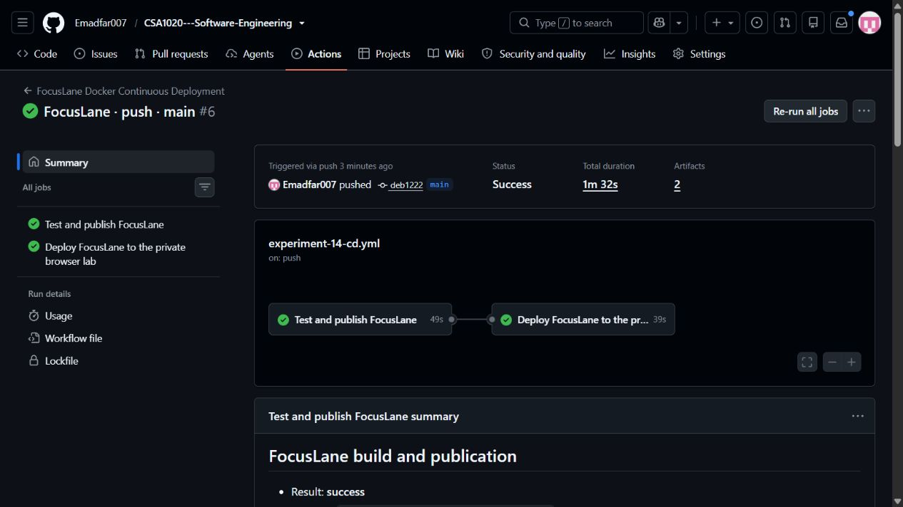
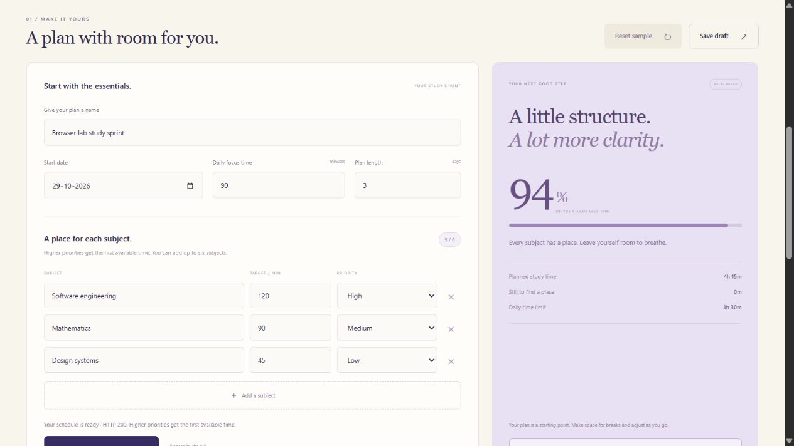
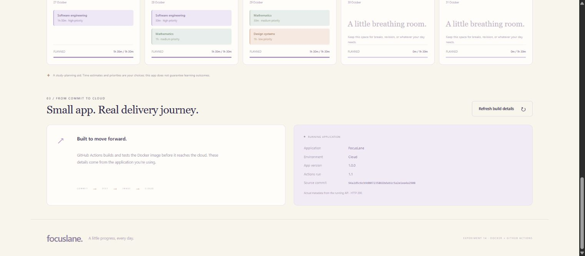
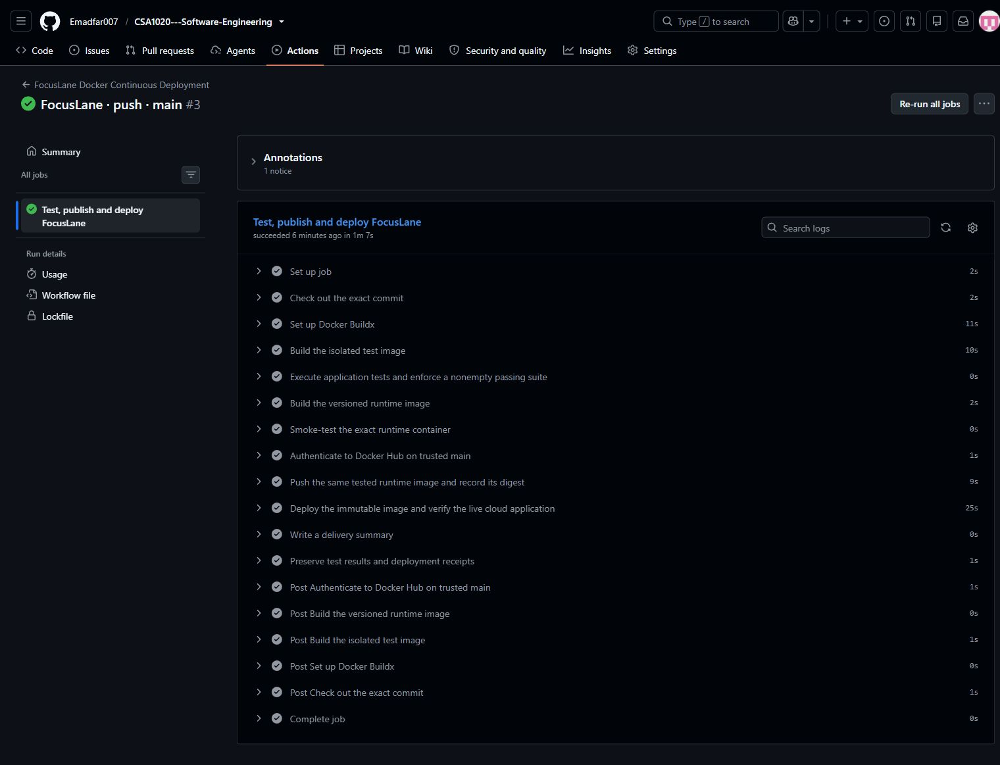
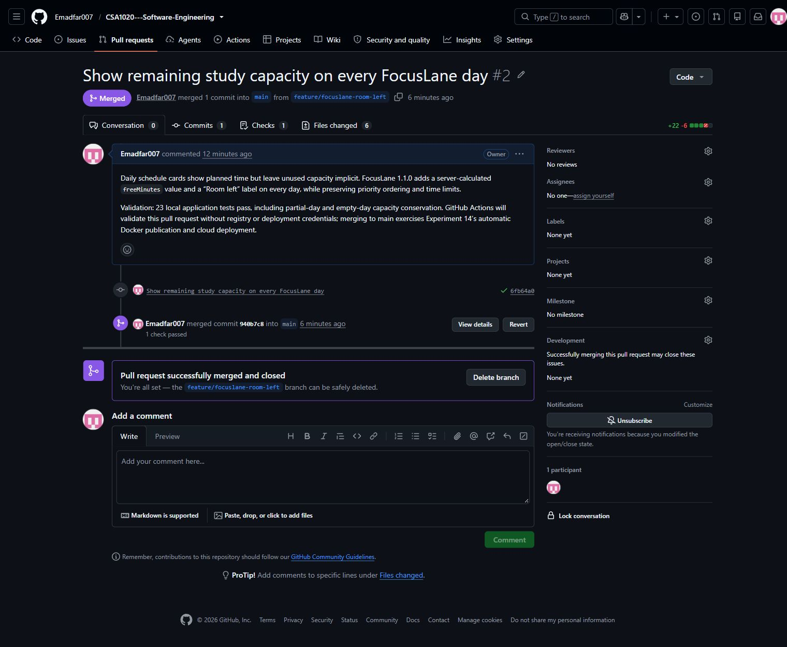
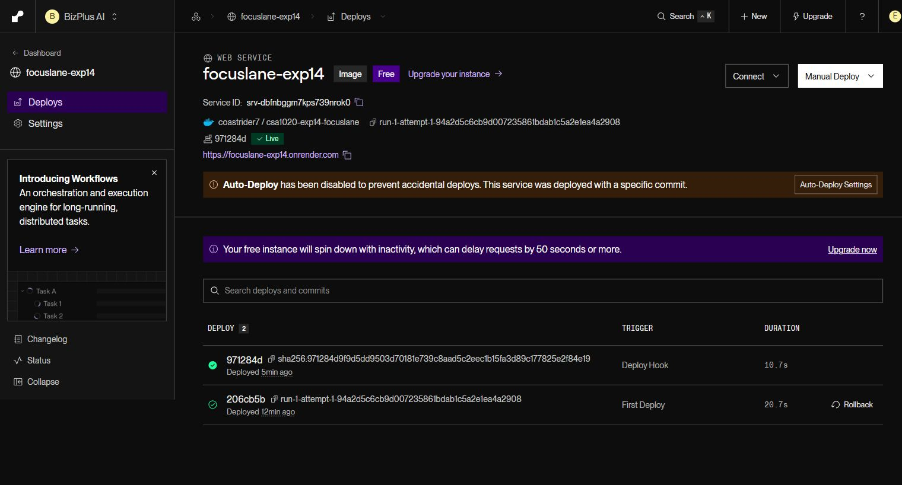

# Experiment 14 — FocusLane: Continuous Deployment with GitHub Actions

## Aim

To automate FocusLane testing, Docker image publication and verified deployment to the existing private Codespaces lab through GitHub Actions after application code reaches `main`.

## Tools Required

**Browser runtime - updated 28 October 2026:** Sign in as **Emadfar007**, resume the [existing Codespace](https://miserable-cobweb-4j9pjv79r7w7fjrqw.github.dev/) and run `bash browser-lab/bin/lab start cicd` from the repository root to start Experiments **13, 14 and 19 together**. The app links require the Codespace and containers to be running. Use `bash browser-lab/bin/lab stop cicd` and stop the Codespace when finished. The existing 2-core lab has a **$0 spending budget with paid usage blocked**, a 30-minute idle timeout and 30-day inactive retention; monthly free compute and storage quotas still apply.

**Verification:** [Automatic browser deployment records](evidence/automatic-browser-deployment-2026-10-28.json) · [Earlier browser runtime checks](evidence/browser-runtime-2026-10-28.json).

**Automatic browser deployment:** The active pipeline now deploys verified new images into the running Codespaces lab. Jenkins handles Experiment 13; hosted Actions and the private outbound deployment agent handle Experiments 14 and 19. Original Render services remain quota-suspended and are retained only as historical deployment evidence.

| Tool | Purpose |
|---|---|
| Git and GitHub | Source control, feature branch, pull request and merge history |
| GitHub Actions | Hosted automation for application pushes and pull requests |
| GitHub Deployments API, Python and OpenSSL | Request exact-image deployment, protect the temporary callback token and wait for verified completion |
| Docker and Buildx | Separate test/runtime images, container execution and build caching |
| Docker Hub | Versioned image publication and immutable registry digests |
| Node.js 24 | Dependency-free HTTP application and application tests |
| Python standard library | Test-report gate, HTTP verification and delivery receipts |
| Render Free web service (original demonstration) | Recorded deployment target; currently quota-suspended |
| GitHub Codespaces and web browser | Receive verified image updates through the private deployment agent |

**Project:** [CSA1020 Software Engineering](https://github.com/Emadfar007/CSA1020---Software-Engineering/tree/main/experiments/experiment-14-github-actions-cd) · **Browser application:** [FocusLane](https://miserable-cobweb-4j9pjv79r7w7fjrqw-8094.app.github.dev) · **Images:** [Docker Hub](https://hub.docker.com/r/coastrider7/csa1020-exp14-focuslane/tags)

The original service used [Render Free](https://render.com/docs/free); that deployment remains quota-suspended. The current app link uses the existing private Codespaces lab.

### Quick access links

| What to open | Link |
| --- | --- |
| Open or manage the browser lab | [Codespaces IDE](https://miserable-cobweb-4j9pjv79r7w7fjrqw.github.dev/) · [Start or stop Codespaces](https://github.com/codespaces) · [Lab guide](https://github.com/Emadfar007/CSA1020---Software-Engineering/tree/main/browser-lab) |
| Open the browser application | [FocusLane - browser app](https://miserable-cobweb-4j9pjv79r7w7fjrqw-8094.app.github.dev/) |
| Check the browser build | [Version and source JSON](https://miserable-cobweb-4j9pjv79r7w7fjrqw-8094.app.github.dev/api/version) · [Health check](https://miserable-cobweb-4j9pjv79r7w7fjrqw-8094.app.github.dev/healthz) |
| Follow the automatic pipeline | [GitHub Actions workflow](https://github.com/Emadfar007/CSA1020---Software-Engineering/actions/workflows/experiment-14-cd.yml) · [Verified browser deployment run 6.1](https://github.com/Emadfar007/CSA1020---Software-Engineering/actions/runs/40740905728) |
| Review the code change that triggered deployment | [Merged feature pull request #2](https://github.com/Emadfar007/CSA1020---Software-Engineering/pull/2) |
| Find the published images | [Docker Hub image and tags](https://hub.docker.com/r/coastrider7/csa1020-exp14-focuslane/tags) |
| Open the historical Render demonstration | [Original successful run #3](https://github.com/Emadfar007/CSA1020---Software-Engineering/actions/runs/40353497794) |
| Manage the original Render service | [Render dashboard - sign-in required](https://dashboard.render.com/web/srv-dbfnbggm7kps739nrok0) |
| Source and pipeline configuration | [Experiment folder](https://github.com/Emadfar007/CSA1020---Software-Engineering/tree/main/experiments/experiment-14-github-actions-cd) · [Dockerfile](https://github.com/Emadfar007/CSA1020---Software-Engineering/blob/main/experiments/experiment-14-github-actions-cd/Dockerfile) · [Active workflow YAML](https://github.com/Emadfar007/CSA1020---Software-Engineering/blob/main/.github/workflows/experiment-14-cd.yml) |
| View the output | [All screenshots](https://github.com/Emadfar007/CSA1020---Software-Engineering/tree/main/experiments/experiment-14-github-actions-cd/screenshots) · [Automatic deployment evidence](https://github.com/Emadfar007/CSA1020---Software-Engineering/tree/main/experiments/experiment-14-github-actions-cd/evidence/automatic-deployment) |
| Open the experiment collection | [All experiments](https://github.com/Emadfar007/CSA1020---Software-Engineering) |

The browser app requires the running Codespaces profile and GitHub sign-in. GitHub Actions checks remain on hosted runners; Render management requires its existing sign-in. The original run #3 link preserves the earlier Render demonstration; verified browser deployment run 6.1 records the new target, and the workflow link shows later runs.

Original deployment URL (quota-suspended): [FocusLane on Render](https://focuslane-exp14.onrender.com/).

## Algorithm

1. **Prepare FocusLane.** Retain editable plan names, dates, time budgets and one to six subjects; priority-based scheduling, capacity warnings, draft saving and JSON export. The multi-stage [Dockerfile](Dockerfile) separates its 23 application tests from the non-root runtime and embeds the exact source SHA and Actions run/attempt.

2. **Start the deployment target.** Resume the existing Codespace as **Emadfar007** and run `bash browser-lab/bin/lab start cicd` before pushing a change. This starts the private applications and outbound deployment agent. The agent deploys only an active matching profile; a stopped Codespace cannot receive a deployment.

3. **Install the workflow and credentials.** Use the supplied [workflow](workflow/experiment-14-cd.yml), installed as `.github/workflows/experiment-14-cd.yml`. Keep registry credentials in `EXP14_DOCKERHUB_USERNAME` and `EXP14_DOCKERHUB_TOKEN`. The current workflow needs no Render hook or Render service variable. Its deployment job receives only the short-lived Actions token with `contents: read` and `deployments: write`.

4. **Trigger and validate.** Push an application, CI-helper, Dockerfile, deployment-protocol or workflow change to `main`, or open a related pull request. The hosted **Test and publish FocusLane** job checks out the exact source, checks the deployment request protocol, builds the test image, runs application and CI guard tests, validates a nonempty passing suite and smoke-tests the versioned runtime. Pull requests stop at validation and receive no registry publication or deployment step.

5. **Publish the exact tested image.** Trusted `main` runs log in temporarily to Docker Hub, publish the versioned image and expose its immutable digest as the successful build job's output. The separate browser deployment job depends on this successful job, so it cannot deploy an image from a failed build.

6. **Request automatic deployment.** The shared [deployment requester](../../browser-lab/ci/request_deployment.py) creates a GitHub Deployment for the exact commit and image digest in environment `codespaces-exp14`. It encrypts the job's temporary callback token to the lab's public key; no personal access token is added to the workflow or repository.

7. **Validate and activate in the private lab.** The outbound [deployment agent](../../browser-lab/ci/deployment_agent.py) checks the repository, trusted `main` event, workflow path, exact source SHA and successful **Test and publish FocusLane** job. It pulls only the expected experiment image, verifies its build identity and checks a restricted canary before replacing the named application container. Activation is verified through the real API; failure restores the previous working release.

8. **Wait for a verified deployment result.** The agent posts `in_progress` and then `success` or `failure` to the GitHub Deployment. Actions waits up to 600 seconds and records success only after the callback names the expected private app URL. An unavailable lab, failed activation or timeout fails the deployment job clearly. Open [FocusLane](https://miserable-cobweb-4j9pjv79r7w7fjrqw-8094.app.github.dev/) and compare `/api/version` with the source and build in the run.

9. **Preserve proof.** Verify the fixed scheduling example: 255 minutes allocated as `[90, 90, 75]`, high priority first, room left `[0, 0, 15]`, and HTTP 400 for a zero daily budget. Capture the Actions run, deployment status, live source/build identity and browser result. [Automatic browser deployment evidence](evidence/automatic-browser-deployment-2026-10-28.json) records the observed run; [current Actions runs](https://github.com/Emadfar007/CSA1020---Software-Engineering/actions/workflows/experiment-14-cd.yml) show subsequent runs.

Hosted runners perform CI without a local computer. Deployment still requires the active Codespace and matching profile. The **$0 spending budget blocks paid usage**, while monthly Codespaces, Actions and storage allowances continue to apply. Stop the lab and Codespace when finished. Artifacts are retained for seven days; submitted evidence remains in the repository.

The original 26 October 2026 Room left feature was delivered through [PR #2](https://github.com/Emadfar007/CSA1020---Software-Engineering/pull/2) and [Render deployment run #3](https://github.com/Emadfar007/CSA1020---Software-Engineering/actions/runs/40353497794). Its original screenshots and receipts below are historical evidence; Render is no longer the active workflow target.

## Output Screenshots

**Automatic browser deployment, 28 October 2026.** The current pipeline, deployment status or matching running build is recorded with the [automatic deployment receipt](evidence/automatic-browser-deployment-2026-10-28.json).



**Earlier browser runtime restoration, 28 October 2026.** FocusLane running from its recorded Docker image in Codespaces.



**Original Render demonstration — 26 October 2026.** The numbered screenshots below preserve that earlier deployment.

**1. Original cloud version.** Version 1.0.0, run 1.1, was recorded before the feature merge.



**2. Deployed planner.** Editable subjects, priorities, dates and daily budgets in the cloud application.


**3. Delivered feature.** Generated schedule cards display Room left using the API's capacity calculation.


**4. Updated build identity.** The running API reports version 1.1.0, run 3.1 and the merged source commit.


**5. Automatic delivery result.** Successful Actions run triggered by the `main` push.


**6. Executed pipeline.** Tests, runtime checks, registry publication and cloud verification.



**7. Pull request validation.** The feature is tested while publication and deployment are skipped.


**8. Feature merge.** The pull request records the change used to test deployment.



**9. Cloud deployment.** Render's live image-backed service and pipeline-initiated deployment.

Render's banner refers to its registry auto-deploy setting after selecting a specific digest. GitHub Actions performs the deployment explicitly through the hook; the new live deployment is marked **Deploy Hook** below.



**10. Published image.** Docker Hub records the runtime's unique tag and registry digest.


The [delivery receipt](evidence/automatic-deployment/focuslane-receipts-3-1/delivery-receipt.json), [before](evidence/cloud-before.json) and [after](evidence/cloud-after.json) cloud responses, [browser export](evidence/browser-export.json), and [stale-plan export](evidence/browser-stale-export.json) provide the corresponding machine-readable evidence.

## Result

**Current deployment path:** The active pipeline targets the private Codespaces lab and accepts deployment only after image identity, health and application checks. Use the [automatic browser deployment receipt](evidence/automatic-browser-deployment-2026-10-28.json) for the captured run, deployed digest and matching live build. This target requires the running Codespace; a failed or unavailable target is reported as a failed deployment.

**Verified automatic deployment — 28 October 2026:** The push-triggered [FocusLane run 6.1](https://github.com/Emadfar007/CSA1020---Software-Engineering/actions/runs/40740905728) completed both the build/publication job and browser deployment job successfully. GitHub Deployment **7393329037** reached success, and the running API matched source `deb12224b0d0c2a7f8142899bb8aa0e805d18238` and build **6.1**. A real stop/start of the CI/CD group retained the new image and restarted the deployment agent.

**Original Render demonstration:** The following results and original screenshots describe the earlier Render run.

**Continuous deployment was demonstrated successfully on 26 October 2026.** Merging the Room left feature triggered GitHub Actions automatically. Run 3 passed, pushed the tested image and deployed it through Render's hook. The public application served the expected source commit and build identity, and its cloud HTTP checks passed.

| Verification | Before the feature | After automatic deployment |
|---|---|---|
| Application version | 1.0.0 | **1.1.0** |
| Actions run/attempt | 1.1 | **3.1** |
| Source commit | `94a2d5c6cb9d007235861bdab1c5a2e1ea4a2908` | `940b7c84efef6e4a8b3e0dd6c1de77bba08705b8` |
| Daily capacity display | Planned time | Planned time and **Room left** |
| Application tests | 22 passing | **23 executed, zero failures, zero skipped** |
| Cloud API checks | Original identity recorded | Health 200; plan 200; invalid input 400 |
| Deployment | Initial bootstrap | `dep-dbfnegvavr4c73fel0gg` — **live**, triggered by deploy hook |

Four CI guard tests also passed. The verified published and deployed image is:

```text
coastrider7/csa1020-exp14-focuslane@sha256:971284d9f9d5dd9503d70181e739c8aad5c2eec1b15fa3d89c177825e2f84e19
```

Browser verification confirmed the one-to-six-subject limits, add/remove controls, editable names and dates, priority ordering, capacity warnings, draft saving and restoration, reset, export, navigation and build refresh. A custom five-day plan starting 2 November allocated 255 minutes at 57% utilization and showed Room left values `[0, 0, 15, 90, 90]`. An over-capacity plan scheduled high-priority Operating systems first and clearly reported 285 unallocated minutes. A 29-minute daily limit produced the specific 30–480-minute validation error and re-enabled submission. Exporting an edited, ungenerated plan correctly returned `schedule: null` instead of attaching stale results. Resetting and reloading restored the sample and cleared the saved draft.

FocusLane remains an educational planning aid. Time estimates and priorities are user choices and do not guarantee learning outcomes.
