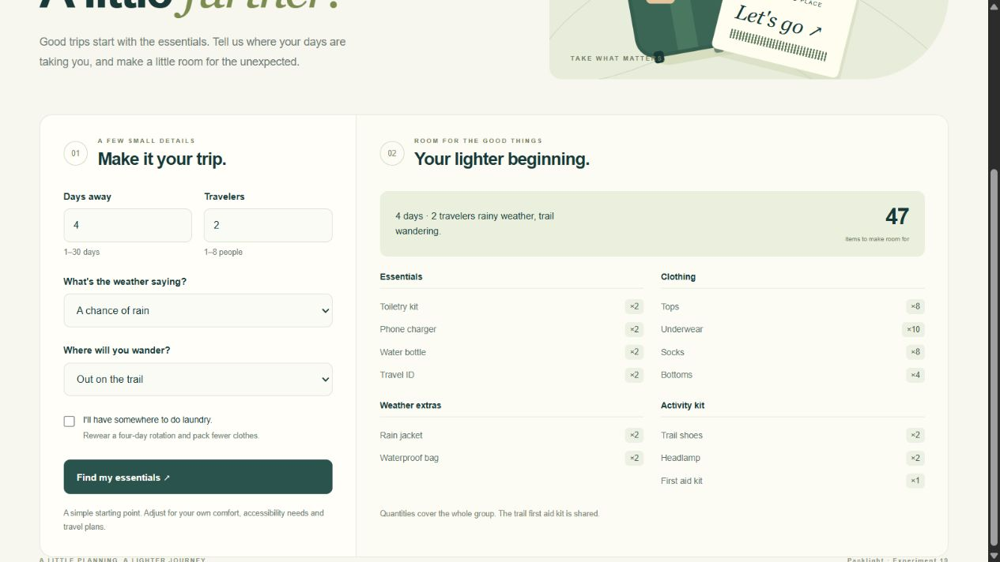
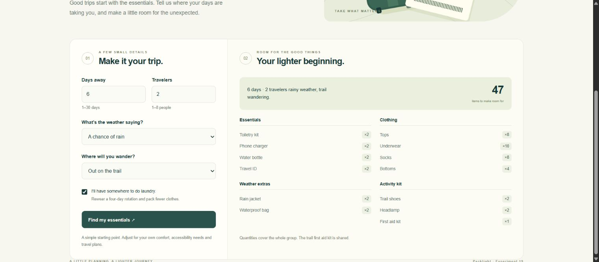

# Experiment 19 — Packlight: Flask CI/CD with GitHub Actions

## Aim

To automate testing, Docker image building, Docker Hub publication and cloud deployment of a containerized Flask application using GitHub Actions.

**Packlight** is a small, stateless trip-packing planner. It generates quantities for essentials, clothing, weather and activities from the number of days, travelers and laundry availability.

## Tools Required

**Browser runtime - updated 28 October 2026:** Sign in as **Emadfar007**, resume the [existing Codespace](https://miserable-cobweb-4j9pjv79r7w7fjrqw.github.dev/) and run `bash browser-lab/bin/lab start cicd` from the repository root to start Experiments **13, 14 and 19 together**. The app links require the Codespace and containers to be running. Use `bash browser-lab/bin/lab stop cicd` and stop the Codespace when finished. The existing 2-core lab has a **$0 spending budget with paid usage blocked**, a 30-minute idle timeout and 30-day inactive retention; monthly free compute and storage quotas still apply.

**Current runtime verification:** [Health, API, image identity and container checks](evidence/browser-runtime-2026-10-28.json).

**Pipeline distinction:** This browser profile runs the recorded immutable Docker image. The original Jenkins/GitHub Actions deployment stages still target Render and remain blocked by **Free Tier Usage Exceeded**. Their saved successful runs and original deployment evidence are retained; starting this profile does not move or rerun the original cloud deployment pipeline.

| Tool | Purpose |
|---|---|
| GitHub repository and GitHub Actions | Source control and automated pipeline |
| Python 3.12, Flask 3.1.3 and Gunicorn 26.2.0 | Application, API and production HTTP server |
| Docker and Buildx | Separate test/runtime images and container execution |
| Docker Hub | Store the tested, versioned image and its immutable digest |
| GitHub Codespaces | Run the recorded image through a private browser port |
| Render Free (original demonstration) | Recorded deployment target; currently quota-suspended |

**Browser application:** [Open Packlight](https://miserable-cobweb-4j9pjv79r7w7fjrqw-8099.app.github.dev/) · [Health](https://miserable-cobweb-4j9pjv79r7w7fjrqw-8099.app.github.dev/healthz) · [Browser build identity](https://miserable-cobweb-4j9pjv79r7w7fjrqw-8099.app.github.dev/api/version)

**Submission:** [Experiment source](https://github.com/Emadfar007/CSA1020---Software-Engineering/tree/main/experiments/experiment-19-github-actions-flask) · [Active workflow YAML](https://github.com/Emadfar007/CSA1020---Software-Engineering/blob/main/.github/workflows/experiment-19-cicd.yml) · [Workflow file copy](workflow/experiment-19-cicd.yml) · [Actions runs](https://github.com/Emadfar007/CSA1020---Software-Engineering/actions/workflows/experiment-19-cicd.yml) · [Docker Hub tags](https://hub.docker.com/r/coastrider7/csa1020-exp19-packlight/tags)

The original [Render Free deployment](https://packlight-exp19.onrender.com/) remains quota-suspended under its [shared service limits](https://render.com/docs/free). The current app link uses the private Codespaces runtime.

## Algorithm

1. Add the Flask application, tests, [Dockerfile](Dockerfile) and [workflow](workflow/experiment-19-cicd.yml) to the existing repository. Install the active workflow at `.github/workflows/experiment-19-cicd.yml`.
2. Store registry access in the existing `EXP14_DOCKERHUB_USERNAME` and `EXP14_DOCKERHUB_TOKEN` GitHub secrets. Store the new service hook in `EXP19_RENDER_DEPLOY_HOOK`; configure `EXP19_CLOUD_URL` and `EXP19_RENDER_SERVICE_ID` as repository variables. Keep credential values out of source.
3. Trigger the workflow when application or pipeline changes are pushed to `main`, when a related pull request opens or changes, or through manual dispatch. Report-only changes do not redeploy the app.
4. Check out the exact source commit and build the Docker `test` target. Run the 20 application tests inside its container; fail on missing, skipped-only or failing tests.
5. Build the non-root `runtime` target with the source SHA and build number. Run the exact runtime image and verify its health, build metadata, packing calculation and invalid-input response over HTTP.
6. On trusted `main` runs, authenticate to Docker Hub and push that same tested image under a unique run/attempt/SHA tag. Record the published `sha256` digest. Pull requests stop after validation.
7. Send the immutable image reference to the dedicated Render service. Wait for the cloud API to report the expected source SHA and build number, then verify the actual application calculation and validation response. A trusted-main deployment failure fails the pipeline.
8. Retain test, smoke-test and deployment receipts as Actions artifacts for seven days and publish a pipeline summary. Open the deployment link and generate a packing list to check the user-facing result.

The Docker stages can also be reproduced from the experiment directory:

```bash
docker build --target test -t packlight-tests .
docker run --rm packlight-tests
docker build --target runtime -t packlight .
docker run --rm -p 127.0.0.1:8000:8000 packlight
```

The example of four days, two travelers, rainy weather and a trail activity produces **47 items**, including one shared first aid kit. The deployed `/api/version` endpoint identifies the source commit and pipeline build.

**Current browser access:** The steps above record the original CI/CD experiment. To run its saved application now, resume the existing Codespace and execute `bash browser-lab/bin/lab start 19` for this experiment alone, or `bash browser-lab/bin/lab start cicd` for all three. Open [Packlight](https://miserable-cobweb-4j9pjv79r7w7fjrqw-8099.app.github.dev/) and use its normal form workflow. The profile pulls the recorded immutable image, keeps the original build identity and requires no local Docker Desktop. Individual profile startup stops other profiles while retaining their data; `stop cicd` stops the three restored profiles without deleting their images or data.

## Output Screenshots

**Current private browser runtime, 28 October 2026.** Packlight running from its recorded Docker image in Codespaces.



**1. Deployed Packlight application.** The working Flask interface and generated packing list.



**2. GitHub Actions pipeline.** The recorded testing, image-publication and deployment run.


## Result

The push-triggered [run 2](https://github.com/Emadfar007/CSA1020---Software-Engineering/actions/runs/40714300739) completed successfully for source `dd4d44cdf641f6c3883a5df0dc8f60526ab40d84`. It passed **20 Docker unit tests**, verified the runtime over HTTP, published the tested image to Docker Hub, deployed its immutable digest to Render and verified the matching live source/build identity and API behavior.

Recorded evidence: [20 test results](evidence/unit-tests.txt) · [Container HTTP checks](evidence/container-smoke.json) · [Image and verified cloud deployment](evidence/cloud-deployment.json) · [Actions run and step results](evidence/github-actions-run.json).

The application was verified at [the original Render deployment](https://packlight-exp19.onrender.com/) during the recorded run. Its current browser runtime is [Packlight in Codespaces](https://miserable-cobweb-4j9pjv79r7w7fjrqw-8099.app.github.dev/), available after starting the profile; the Render service remains quota-suspended. The 47-item API fixture passed, and the browser workflow generated 59 items for a six-day rainy trail trip for two travelers, then reduced the list to 47 with laundry enabled. The submitted YAML and original deployment evidence record the complete automated pipeline; the current app link uses the separate Codespaces runtime.
